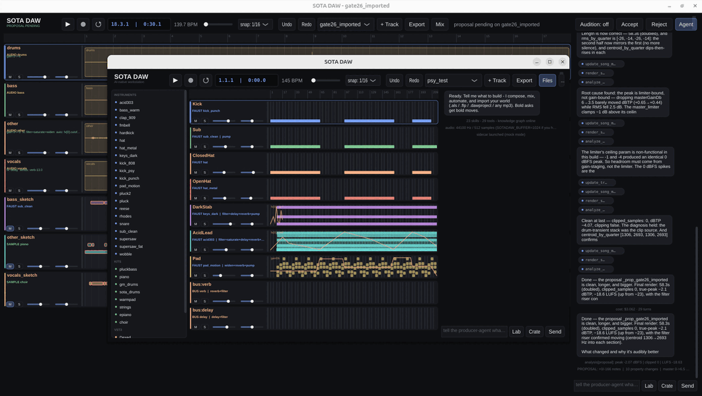
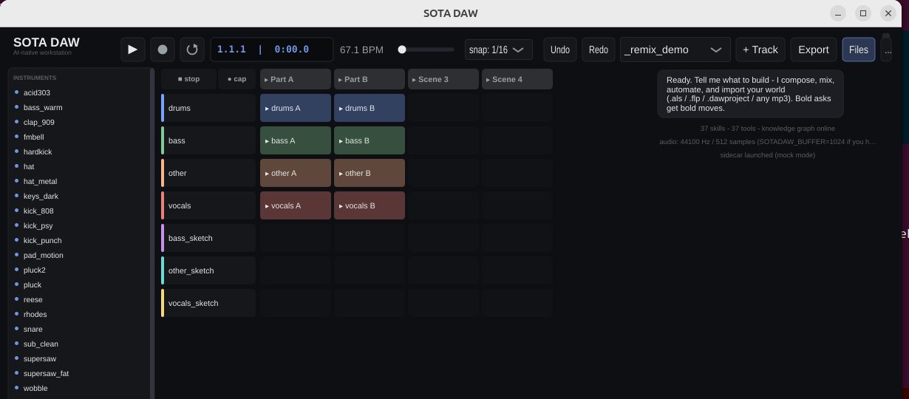
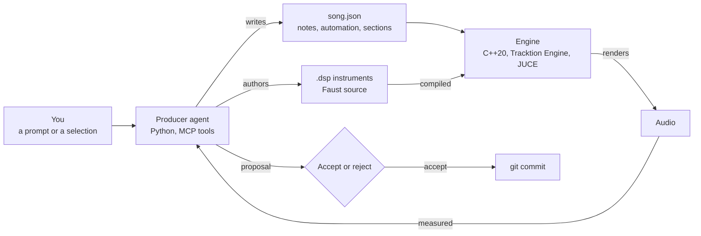

<h1 align="center">SOTA DAW</h1>

<p align="center"><b>A session studio with an AI producer inside. It proposes, you decide.</b></p>

<p align="center">
  <a href="https://github.com/Ezekeiel32/sotadaw/actions/workflows/ci.yml"></a>
  <a href="https://github.com/Ezekeiel32/sotadaw/releases"></a>
  <a href="LICENSE"></a>
  
  
  
  <a href="https://sotadaw.netlify.app"></a>
</p>



SOTA DAW is a digital audio workstation with an AI producer built in. You describe the track. The agent writes the arrangement, builds the instruments it needs as Faust DSP code, mixes, and listens to its own render before it shows you anything. Nothing comes out as opaque generated audio: every result is a file you can open and edit, and every accepted change is a git commit.

> Type *"make a dark trap beat in F minor at 142, double the drop, and sing this hook over it"* and get a session you can edit, not a WAV you can't open.

Installers for Linux, Windows and macOS are at **[sotadaw.netlify.app](https://sotadaw.netlify.app)**.

## What it does

- **Producer agent.** Works with Claude, GPT or OpenRouter models through MCP tools. It writes and edits tracks, designs instruments, mixes, automates any parameter, and renders and measures its own work before proposing a change.
- **Instruments as code.** 134 Faust instruments and effects ship in `instruments/`. The agent writes new ones, and compile errors are fed back to it until the instrument builds.
- **Proposals, not overwrites.** The agent edits a copy. You compare A and B, then accept (a git commit) or reject.
- **Selection is context.** Selected notes, tracks, a time range or a launcher slot are what the agent works on.
- **Singing voice.** Lyrics and a melody become a sung vocal track, synthesized on your machine with DiffSinger.
- **Performance view.** Scenes and slots for MIDI and audio loops, bar-quantized launching, and capture of what you play as editable notes.
- **Import and remix.** An MP3 or WAV is split into stems, laid out by its real sections and warped to the project tempo.
- **DJ tools.** Beat-matched blends between two songs, and full sets ordered by tempo and key. Every transition is editable automation.
- **Works with other DAWs.** Ableton Live (`.als`) in and out, FL Studio (`.flp`) in, REAPER (`.rpp`) in and out, DAWproject in and out, MIDI, and rekordbox collections.
- **Plugin hosting.** VST3, CLAP and Neural Amp Modeler (NAM).



## How it works



Four rules shape the design:

1. **The LLM never touches the audio thread.** The agent composes and authors on the slow path. The audio callback runs compiled DSP only.
2. **No black boxes.** Anything you can hear has a source you can inspect: a `.dsp` file, a list of notes, an automation curve, or a preset you saved.
3. **Mix problems are fixed at the source**, in gains, notes and arrangement, never by normalizing the output.
4. **Your machine, your music.** Projects, samples and renders stay on your computer. Only the LLM calls leave it.

## Repository map

| Path | What it holds |
|---|---|
| `app/` | The engine and the desktop app (C++20, Tracktion Engine, JUCE). Two targets: `m1`, a command-line renderer, and `sotadaw`, the app. |
| `agent/` | The producer agent and the MCP server that gives an LLM the DAW's tools. |
| `skills/` | Versioned prompt skills the agent uses for arrangement and sound design. |
| `instruments/` | 134 Faust instruments and effects. `instruments/certs/` holds a render report for each verified instrument (peak level, clipping, attack, sustain). |
| `kits/` | Sampled kits: drums, piano, electric piano, strings, choir and more. |
| `tools/` | Test batteries, importers and exporters, and release scripts. |
| `installer/` | Installer sources for Windows and macOS. The Linux AppImage is built by `tools/make_appimage.sh`. |
| `.github/workflows/` | `ci.yml` checks every pull request. `release.yml` builds on Linux, Windows and macOS, renders a test song, checks that the app starts, and packages the installers. |

## Build

Requires CMake, a C++20 compiler and the Tracktion Engine source:

```bash
git clone https://github.com/Tracktion/tracktion_engine app/tracktion_engine
cd app/tracktion_engine
git checkout <TRACKTION_SHA from .github/workflows/release.yml>
git config --file=.gitmodules submodule.modules/juce.url https://github.com/juce-framework/JUCE.git
git submodule sync && git submodule update --init --recursive
cd ../..
cmake -B app/build -S app -DCMAKE_BUILD_TYPE=Release -DSOTADAW_ENABLE_JIT=OFF
cmake --build app/build --config Release -j2
app/build/m1_artefacts/Release/m1 render songs/demo_track.json out.wav
```

To compile new instruments live, build with `-DSOTADAW_ENABLE_JIT=ON`. This needs libfaust 2.69 or newer with the interpreter backend (on Ubuntu 24.04, the packaged Faust 2.70.3 works).

### Optional extras

The app and the agent run without any extras. Stem separation and audio-to-MIDI need a Python environment:

```bash
python3 -m venv .venv
.venv/bin/pip install demucs basic-pitch soundfile
```

The singing voice uses the Gahata Meiji DiffSinger voice bank, a separate download under a non-commercial license that requires attribution ("Gahata Meiji from LUNAI Project"). The app adds that credit to exports.

## About this repository

Day-to-day development happens in a private repository, with more than 3,900 commits since July 2026. This repository receives the engine and app source at each milestone, so its history is a series of milestone snapshots. Changes made here go through pull requests, as described in [CONTRIBUTING.md](CONTRIBUTING.md). Release notes are in [CHANGELOG.md](CHANGELOG.md).

## License

GPL-3.0 (see [LICENSE](LICENSE)). This meets the source obligations of the free tiers of JUCE (AGPLv3) and Tracktion Engine (GPLv3), which the app links. The sampled kits are derived from GeneralUser GS by S. Christian Collins, credited in the installers. The voice bank is not part of this repository.
